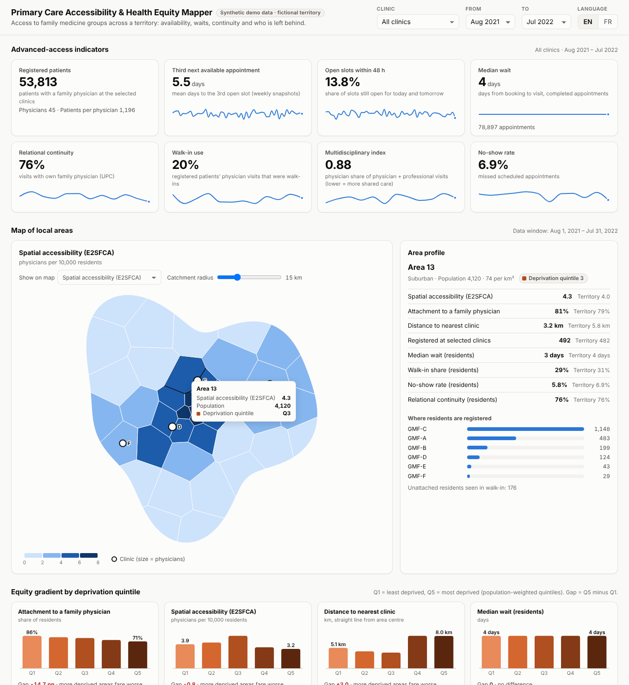

*Last updated: November 6, 2026*

# Primary Care Accessibility & Health Equity Mapper

An interactive web dashboard that shows **how accessible primary care is across a territory, and for whom**. It combines
the advanced-access indicators that family medicine groups (GMF) can extract from their electronic medical records (EMR)
with a map of local areas, a spatial accessibility measure and a deprivation gradient. The goal is to make
complex public-health findings readable at a glance by clinicians, managers and decision-makers.



> **All data in this repository is synthetic.** The territory, its 40 areas, the six clinics, the 59,000 patients
> and the 120,000 visits are generated by a seeded script. No real patient, clinic or place is represented: the
> territory's coordinates are deliberately set in the open North Atlantic so it cannot be mistaken for a real area.

## Background

The indicators come from a sequential multi-method study with eight family medicine groups in Quebec (2021-2022):
a systematic review of 81 papers on advanced access, a 17-member expert committee, and extraction from three EMR
products. Six indicators could be extracted reliably and went into a dynamic dashboard, together with a demand and
supply profile for each physician:

> Breton M, Gaboury I, Bordeleau F, Lamoureux-Lamarche C, Martin É, Deslauriers V, Deville-Stoetzel J-B.
> *Use of Electronic Medical Record Data to Create a Dashboard on Access to Primary Care.*
> Healthcare Policy. 2023;18(4):72-88. doi:10.12927/hcpol.2023.27092

This project is the visualization layer. The indicators themselves are computed by the companion C++ engine
**emr-access-indicators** (`emr_access`), which lives in the sibling folder. This dashboard adds what the engine does
not cover: **geography, spatial accessibility and equity**.

## What the dashboard shows

| Section | What you see | How to use it |
|---|---|---|
| **Advanced-access indicators** | 8 tiles: registered patients, third next available appointment (TNAA), open slots within 48 h, median wait, relational continuity, walk-in use, multidisciplinary index, no-show rate, each with a trend sparkline | Choose a clinic and a period at the top; the tiles compare it with the whole territory |
| **Map of local areas** | Choropleth of 9 measures: spatial accessibility (E2SFCA), attachment to a family physician, deprivation quintile, distance to the nearest clinic, registered patients per 1,000, and residents' median wait, walk-in share, no-show rate and continuity. Clinics are drawn as circles sized by number of physicians | Hover for details, click an area to pin its profile, drag the catchment-radius slider to recompute accessibility live |
| **Area profile** | The selected area against the territory, and which clinics its residents are registered with | Click an area again (or *Clear selection*) to release it |
| **Equity gradient** | Eight small charts from Q1 (least deprived) to Q5 (most deprived), with the Q5 - Q1 gap and whether more deprived areas fare better or worse | Follows the clinic and period filters |
| **Wait-time distribution** | Histogram of days from booking to visit, with median and 90th percentile; or cumulative curves ("% seen within *n* days") by clinic or by deprivation quintile | Toggle *Distribution / By clinic / By quintile* |
| **Indicator trends** | Weekly (TNAA, open slots) or monthly lines for each clinic; the selected clinic is highlighted | Pick the indicator from the menu |
| **Resource allocation** | Demand vs. supply per physician (or per clinic): visits to own patients, colleagues' patients and unregistered patients, against expected demand; discipline mix of visits; capacity table with physicians per 10,000 in each clinic's catchment | |
| **Data table** | Every area and measure in a sortable table: the accessible alternative to the map | Click a column header to sort, click a row to select the area |

Other features:

* **English / French** interface (FR is chosen automatically for French-language browsers).
* **Light and dark** themes follow the system setting.
* **Shareable views**: the clinic, period, map measure, catchment radius and selected area are kept in the URL.
* **Small-number suppression**: area measures based on fewer than 20 visits are hatched instead of shown.
* Works **offline** and straight from disk: no server, no network, no tracking.

## Quick start

Open `index.html` in a web browser. That's it: the data is in `data/dashboard.js`.

Or serve the folder locally (Node.js 12 or later):

```sh
npm start            # http://localhost:8080
```

## How it works

```
 pipeline/synth.js         emr_access (C++)              pipeline/build-data.js        index.html
 ─────────────────         ─────────────────             ──────────────────────        ──────────
 fictional territory  ──►  indicators.csv          ──►   data/dashboard.js        ──►  vanilla JS + D3 6.3.1
 + EMR extracts            demand_supply.csv              (one bundle, ~1.3 MB)          all filtering and
   data/territory/           data/engine/                                                maths in the browser
   data/raw/
```

1. **`pipeline/synth.js`** draws a fictional territory (Voronoi cells inside an irregular boundary, with a city,
   two villages and rural land), assigns population, age mix, a population-weighted deprivation quintile and an
   attachment rate to each area, places six clinics, and writes EMR extracts in exactly the input format of
   `emr_access` (`providers.csv`, `patients.csv`, `visits.csv`, `slots.csv`). Patients carry an extra `area_id`
   column (area of residence), which the engine ignores. Rosters are spread over areas with a gravity model balanced
   by iterative proportional fitting, so both clinic roster sizes and area attachment rates hold. The same `--seed`
   always produces identical files.
2. **`emr_access`** (companion repository) computes the indicators by clinic, provider, week and month.
3. **`pipeline/build-data.js`** joins everything into one bundle:
   * an additive **count cube** *area × clinic × month × measure* (visits, walk-ins, continuity numerator and
     denominator, no-shows, waits, ...);
   * **wait-time counts** by *area × clinic × month × days*, so medians and percentiles can be recomputed exactly
     for any filter;
   * registered patients by area and clinic, and straight-line distances from each area centre to each clinic;
   * the engine's indicator series and demand/supply table.
4. **The page** (`js/app.js`) sums the cube for the current filters and draws the charts with D3. Because the bundle
   stores counts rather than rates, every proportion is re-aggregated from numerators and denominators, and medians
   come from the full distribution, never averaged.

### Methods

* **Spatial accessibility: enhanced two-step floating catchment area (E2SFCA)** (Luo & Qi, 2009), with a Gaussian
  distance decay that reaches zero at the catchment radius. Step 1: each clinic's physicians are divided by the
  distance-weighted population around it. Step 2: each area sums the ratios of the clinics it can reach. The result is
  read as physicians per 10,000 residents. Distances are straight-line from the area centre (no road network).
* **Deprivation quintiles** are population-weighted (each quintile holds about 20% of residents), as for the
  Pampalon index.
* **Indicator definitions** follow emr-access-indicators and the manuscript: TNAA is the provider-weighted mean of
  clinic values; open slots, continuity (UPC), walk-in use, multidisciplinary index and no-shows are pooled
  proportions; wait times are calendar days from booking to visit for completed scheduled appointments.
* **Area measures for residents** pool every visit residents made to the selected clinics. The walk-in share at area
  level includes unregistered residents, unlike the clinic-level walk-in indicator, which counts registered patients only.
* **Synthetic effects.** To make the equity views worth demonstrating, the generator builds in modest gradients:
  more deprived areas have lower attachment, more walk-in use, slightly lower continuity, more no-shows and slightly
  longer booking delays; distance increases no-shows. **These are assumptions, not findings.**

## Regenerating the demo data

This needs the companion engine built in the sibling folder `../emr-access-indicators`:

```sh
cd ../emr-access-indicators
cmake -S . -B build -DCMAKE_BUILD_TYPE=Release && cmake --build build --config Release
cd ../access-dashboard-viz
npm run demo        # synth -> emr_access -> build-data  (about 3 seconds)
```

The steps can also be run one at a time: `npm run synth`, `npm run engine` (or set `EMR_ACCESS=/path/to/emr_access`),
`npm run build-data`.

## Using your own data

1. **Territory** (`data/territory/`):
   * `areas.geojson`: one Polygon or MultiPolygon feature per area, in WGS84 lon/lat, with the properties
     `area_id`, `population` (required), and optionally `name_en`, `name_fr`, `deprivation_quintile` (1-5),
     `attachment_rate` (0-1) and `urban_class` (`urban` / `suburban` / `rural`).
   * `clinics.csv`: `clinic_id, name_en, name_fr, kind, lon, lat`.
2. **EMR extracts** in the emr-access-indicators format, with an `area_id` column added to `patients.csv`
   (patients without one are counted as "unknown area": they appear in clinic totals, not on the map).
3. Run `emr_access` on the extracts, then:

```sh
node pipeline/build-data.js --territory DIR --raw DIR --engine DIR --from YYYY-MM-DD --to YYYY-MM-DD --real-data
```

`--real-data` removes the "synthetic" badge. **Keep real extracts out of version control**: `data/raw/` and
`data/engine/` are already in `.gitignore`, but `data/dashboard.js` contains aggregated counts and should be reviewed
for small cells before it is shared.

## Testing

```sh
npm test                 # 25 tests, no dependencies
npm run test:browser     # optional: needs Playwright (npm install --no-save playwright)
```

* **Unit tests** (`tests/core.test.js`): calendar arithmetic over 1900-2100, timestamp and CSV parsing (BOM, CRLF,
  quotes, semicolons), haversine distance, polygon area and centroid, the seeded random generator, percentiles
  (checked against the expanded sample in 200 random trials) and a hand-computed E2SFCA example.
* **Pipeline tests** (`tests/pipeline.test.js`): `build-data.js` on a small fixture whose every count was derived
  by hand (French aliases, unknown areas, unregistered walk-ins, the wait overflow bin); then **cross-checks of the
  shipped bundle against the engine**: for every clinic and month, the median and 90th percentile wait recomputed in
  JavaScript equal `emr_access`'s values, and no-show, continuity, walk-in and mean-wait numerators and denominators
  match exactly.
* **Browser check** (`tests/browser-check.js`): loads the page from disk and over HTTP in headless Chromium, fails
  on any console error, exercises every map measure, trend, filter and the language switch, checks that the URL
  state survives a reload and that the phone layout has no horizontal scroll, and saves screenshots.

The tests and the data generator were also run under **Node.js 12.22** (2019 LTS) and give identical output.

## Technology

Every tool here was available by the end of 2020:

| Tool | Version | Released |
|---|---|---|
| D3.js (bundled in `js/vendor/`, ISC licence) | 6.3.1 | December 2020 |
| JavaScript | ES2019, no build step, no framework | |
| Node.js (data pipeline and tests, standard library only) | 12 or later | 2019 |
| Playwright (optional browser check) | any 1.x | 1.0: May 2020 |
| emr-access-indicators (companion engine) | C++17, CMake | |

There are no npm dependencies. Colours come from a palette validated for colour-vision deficiency, with separate
light and dark values. Every chart has hover tooltips, every colour encoding is backed by a label or legend, and the
map has a full data table.

## Project layout

```
index.html               the dashboard
css/dashboard.css        layout and light/dark colour tokens
js/app.js                state, filters, wiring
js/charts.js             chart components (sparkline, histogram, lines, stacked bars, quintile bars)
js/map.js                choropleth with clinic markers
js/metrics.js            calculations shared by the browser and the tests (percentiles, E2SFCA, aggregation)
js/i18n.js               English and French text and number formats
js/vendor/               D3 6.3.1 and its licence
data/dashboard.js        the data bundle the page loads (synthetic demo)
data/territory/          demo territory: areas.geojson, clinics.csv
pipeline/                synth.js, run-engine.js, build-data.js, serve.js, lib/common.js
tests/                   run.js, *.test.js, fixtures/, browser-check.js
docs/screenshot.png
```

## Limitations

* Distances are straight lines, not road travel times, and supply is a head count of physicians, not full-time
  equivalents.
* Registration is a snapshot; changes of family physician during the period are not modelled.
* Area-level measures only cover visits to the clinics in the extract. Residents who use other clinics are invisible.
* The synthetic gradients illustrate the views and say nothing about any real population.

## References

* Breton M, et al. Use of Electronic Medical Record Data to Create a Dashboard on Access to Primary Care. *Healthcare
  Policy*. 2023;18(4):72-88.
* Luo W, Qi Y. An enhanced two-step floating catchment area (E2SFCA) method for measuring spatial accessibility to
  primary care physicians. *Health & Place*. 2009;15(4):1100-1107.
* Pampalon R, Hamel D, Gamache P, Raymond G. A deprivation index for health planning in Canada. *Chronic Diseases in
  Canada*. 2009;29(4):178-191.
